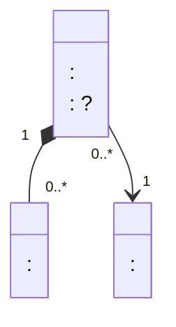

<!--
Map of one subdomain – ‹problem-space›/<subdomain>/subdomain-map.md, beside the business object
folders; the domain map links it. It shows the structure of the subdomain: its business objects,
what each holds and how they relate, like a class diagram of the problem space. Whoever creates it
(problem-space-initialization, problem-space-fr) sets its link in the domain map in the same change.

- A class per business object (aggregate root) and per entity of it that the structure needs. A
  value is no class: it is the type of an attribute.
- Composition (*--): the entity lives and dies with its root. Association (-->): a reference by
  identity to another business object of this subdomain, with its own life. Multiplicities in
  quotes ("1", "0..1", "0..*") and a label in business terms on every relationship.
- Attributes in business language, written `name: Type`; the type is a term of the glossary
  (a Value or a plain business type), `Type?` if the attribute is optional. No operations (commands
  stand in the glossary and the FRs), no visibility, no code types.
- Inheritance (<|--) only where the business itself names a specialisation; otherwise a kind is an
  attribute.
- Class ids are ASCII (umlauts spelled out as in the folder names), the term in `‹problem-space-language›`
  stands in the label: class ManuelleFrist["Manuelle Frist"].
- Terms and their meaning stand only in the glossary, rules only in the FRs. Relationships to other
  subdomains stand in the domain map, not here; a business object of another subdomain does not
  appear in this diagram.
This comment is not copied into the map.
-->
# <subdomain> – Subdomain Map

